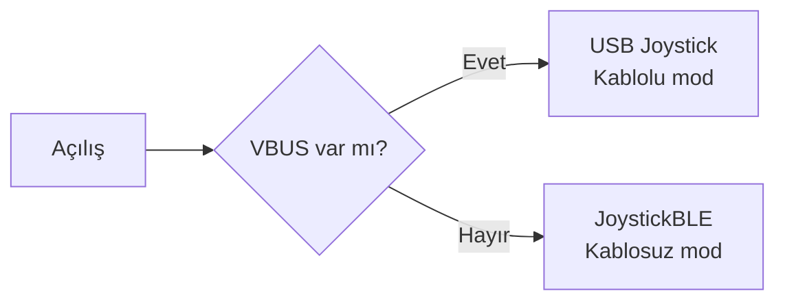

# Goblins Keyboard Hitbox Pico W Oyun Kolu: USB (Kablolu) ve BLE (Kablosuz) Çift Mod

Raspberry Pi Pico W ile yapılmış, **hem USB HID hem de Bluetooth Low Energy (BLE) HID** olarak çalışan bir oyun kolu. Arduino IDE ve [arduino-pico](https://github.com/earlephilhower/arduino-pico) çekirdeği kullanılır.

## İçindekiler

- [Genel Bakış](#genel-bakış)
- [Gerekli Malzemeler](#gerekli-malzemeler)
- [Arduino IDE Kurulumu](#arduino-ide-kurulumu)
- [Donanım Bağlantıları](#donanım-bağlantıları)
- [Yazılım](#yazılım)
- [Yükleme](#yükleme)
- [Test](#test)
- [Sorun Giderme](#sorun-giderme)
- [Bilinen Sınırlamalar](#bilinen-sınırlamalar)
- [Hızlı Kontrol Listesi](#hızlı-kontrol-listesi)

---

## Genel Bakış

| Mod | Ne zaman | Nasıl görünür |
|---|---|---|
| **Kablolu** | Veri USB-C portu bilgisayara takılıyken | USB HID oyun kolu |
| **Kablosuz** | Kol pil ile açıldığında (USB yokken) | BLE HID oyun kolu |

- Kolda **iki USB-C portu** vardır: biri **yalnızca şarj** (TP4056 modülüne), diğeri **yalnızca veri** (Pico W'ye) içindir.
- Mod seçimi **açılışta**, Pico W'nin VBUS (USB gücü) girişinin okunmasıyla otomatik yapılır.



> [!IMPORTANT]
> **Kütüphane karışıklığı:** İnternette sıkça önerilen `BleGamepad` kütüphanesi **yalnızca ESP32 içindir** ve Pico W'de çalışmaz. `BTstackLib` ve `Adafruit_TinyUSB` de bu çözümde gerekmez.
> Gereken her şey arduino-pico kartı paketinin içinde hazır gelir (`Joystick` ve `JoystickBLE`). Kütüphane yöneticisinden ayrıca bir şey kurmanız gerekmez.

---

## Gerekli Malzemeler

- Raspberry Pi Pico W (1 adet)
- TP4056 şarj modülü, **koruma devreli** sürüm (DW01 + 8205A yongalı, genelde 6 pinli)
- 3.7 V Li-Po / Li-Ion pil (kapasiteye göre seçin)
- USB-C soket kartı, 2 adet (biri şarj, biri veri; veri için VBUS, GND, D+, D− pinleri çıkış veren tür)
- SPST (tek kutuplu) kaydırmalı anahtar, pil hattı için
- 16 adet buton (4 yön, 4 aksiyon, 2+2 omuz tuşu, 2 analog tuşu, Start, Select)
- Bağlantı kabloları, lehim malzemeleri

---

## Arduino IDE Kurulumu

### arduino-pico kart paketini ekleme

1. Arduino IDE'de **Dosya → Tercihler** menüsünü açın.
2. **Ek Kart Yöneticisi URL'leri** alanına şu adresi yapıştırın:
   ```
   https://github.com/earlephilhower/arduino-pico/releases/download/global/package_rp2040_index.json
   ```
3. **Araçlar → Kart → Kart Yöneticisi** menüsünü açın.
4. Arama kutusuna `pico` veya `Earle Philhower` yazın.
5. **"Raspberry Pi Pico/RP2040" – Earle F. Philhower, III** paketini kurun.

> [!WARNING]
> "Arduino Mbed OS RP2040 Boards" paketi farklı bir çekirdektir. Bu proje için **onu kullanmayın**.

### Kart ve araç ayarları

| Ayar | Değer |
|---|---|
| Araçlar → Kart | Raspberry Pi Pico W |
| Araçlar → IP/Bluetooth Stack | Bluetooth etkin olan seçenek (ör. "IPv4 + Bluetooth") |
| Araçlar → USB Stack | Pico SDK (varsayılan; **Adafruit TinyUSB seçmeyin**) |

> [!NOTE]
> Bluetooth seçeneği açık değilse `JoystickBLE` derlenmez. USB Stack olarak Adafruit TinyUSB seçilirse yerleşik `Joystick` sınıfı çalışmaz.

### Yerleşik kütüphaneleri kontrol etme

Kütüphane Yöneticisi'nde `Joystick` araması yapmanıza gerek yoktur; bu kütüphaneler kart paketiyle birlikte gelir. Kontrol etmek için:

- **Taslak → Kütüphane Ekle** menüsünün altında Pico W'ye ait kütüphaneler listelenir.
- **Dosya → Örnekler** altında Pico W için Joystick ve Bluetooth örnekleri bulunur.

---

## Donanım Bağlantıları

### Buton pinleri

Tüm butonlar bir bacağı ilgili GPIO'ya, diğer bacağı GND'ye gelecek şekilde bağlanır. Kod dahili pull-up direnci kullanır; **dışarıdan direnç gerekmez**. Basılı = `LOW`.

| Fonksiyon | GPIO | | Fonksiyon | GPIO |
|---|---|---|---|---|
| Sol | 15 | | B | 20 |
| Aşağı | 13 | | X | 19 |
| Sağ | 14 | | Y | 18 |
| Yukarı | 12 | | Omuz L | 16 |
| Start | 2 | | Omuz R | 17 |
| Select | 3 | | Omuz 2 L | 4 |
| A | 5 | | Omuz 2 R | 27 |
| | | | Analog tuşu L | 26 |
| | | | Analog tuşu R | 22 |

### Güç ve şarj bağlantısı (iki USB-C port)

İki hat birbirinden ayrı olduğu için şarj kablosunu takmak Pico'yu kendiliğinden açmaz. Pil hattı bir anahtarla Pico'ya bağlanır.

| Bağlantı | Nereye |
|---|---|
| Şarj portu VBUS | TP4056 IN+ |
| Şarj portu GND | TP4056 IN− |
| Şarj portu D+ / D− | Bağlanmaz |
| TP4056 B+ / B− | Pil (kalıcı bağlı) |
| TP4056 OUT+ | Anahtar üzerinden → Pico **VSYS** (pin 39) |
| TP4056 OUT− | Ortak GND (Pico GND) |
| Veri portu VBUS | Doğrudan Pico **VBUS** (pin 40) |
| Veri portu GND | Pico GND |
| Veri portu D+ / D− | Pico USB D+ / D− (test noktaları veya mikro-USB breakout) |

> [!NOTE]
> Bu bölüm şu varsayıma dayanır: anahtar yalnızca pil hattında (TP4056 OUT+ ile VSYS arasında) bulunur ve veri portunun VBUS hattı anahtarsız Pico'nun VBUS pinine gider. Bağlantınız farklıysa bu bölümü ona göre düzenleyin.

### Çalışma durumları

| Durum | Sonuç |
|---|---|
| Anahtar kapalı, veri kablosu yok | Pico kapalı. Şarj portuna kablo takılıysa pil şarj olur. |
| Anahtar açık, veri kablosu yok | Pico pilden çalışır, VBUS düşük okunur, kol **BLE modunda** açılır. |
| Veri kablosu bilgisayara takılı | VBUS yüksek okunur, kol **kablolu modda** açılır. Pico bu durumda anahtardan bağımsız olarak VBUS'tan beslenir. |
| Şarj portu takılı | Pil şarj olur. Kol açıksa kablosuz modda oynanırken şarj devam eder. |

### Güvenlik notları

- Pico'nun kendi üzerinde VBUS ile VSYS arasında bir diyot vardır. Pilden USB portuna geri akım olmaması için ek diyot gerekmez.
- TP4056 modülünün **koruma devreli** sürümünü kullanın. Koruması olmayan 4 pinli sürüm, pil boşaldığında kesme yapmaz ve Li-Po'ya zarar verebilir.
- Veri portunun VBUS hattı Pico'nun VBUS pinine bağlı değilse kod daima BLE modunu seçer.
- Şarj portunun 5 V hattını Pico'nun VBUS veya VSYS pinine **bağlamayın**. Yalnızca TP4056 girişine gitmelidir.
- Lehim sonrası **kısa devre kontrolü** yapmadan pili bağlamayın.

---

## Yazılım

### Çalışma mantığı

1. Açılışta tüm buton pinleri `INPUT_PULLUP` olarak ayarlanır.
2. Pico W'nin kablosuz yongasındaki VBUS algılama pini (`CYW43_WL_GPIO_VBUS_PIN`) okunur.
3. VBUS varsa USB `Joystick`, yoksa `JoystickBLE` başlatılır.
4. Döngüde her 5 ms'de butonlar okunur; rapor **yalnızca bir buton veya D-pad durumu değiştiğinde** gönderilir.
5. D-pad dört yönden oluşan 8 yönlü "hat" değerine çevrilir.

### Tam kod

Aşağıdaki kodu yeni bir taslağa yapıştırın:

```cpp
#include <Arduino.h>
#include <Joystick.h>      // USB joystick (built into arduino-pico)
#include <JoystickBLE.h>   // BLE joystick (built into arduino-pico)
#include "pico/cyw43_arch.h"

// Pin layout
const int PIN_LEFT = 15, PIN_DOWN = 13, PIN_RIGHT = 14, PIN_UP = 12;
const int PIN_START = 2, PIN_SELECT = 3;
const int PIN_A = 5, PIN_B = 20, PIN_X = 19, PIN_Y = 18;
const int PIN_SHOULDER_L = 16, PIN_SHOULDER_R = 17;
const int PIN_SHOULDER_2_L = 4, PIN_SHOULDER_2_R = 27;
const int PIN_ANALOG_BTN_L = 26, PIN_ANALOG_BTN_R = 22;

// Buttons in order -> joystick buttons 1..12
const int buttonPins[] = {
  PIN_A, PIN_B, PIN_X, PIN_Y,
  PIN_SHOULDER_L, PIN_SHOULDER_R, PIN_SHOULDER_2_L, PIN_SHOULDER_2_R,
  PIN_ANALOG_BTN_L, PIN_ANALOG_BTN_R, PIN_START, PIN_SELECT
};
const int NUM_BUTTONS = sizeof(buttonPins) / sizeof(buttonPins[0]);

bool isWiredMode = false;
uint32_t lastState = 0xFFFFFFFF;  // forces one report at startup

// Returns hat angle in degrees, or -1 when centered
int readHat() {
  bool up    = digitalRead(PIN_UP)    == LOW;
  bool down  = digitalRead(PIN_DOWN)  == LOW;
  bool left  = digitalRead(PIN_LEFT)  == LOW;
  bool right = digitalRead(PIN_RIGHT) == LOW;

  if (up && right)   return 45;
  if (down && right) return 135;
  if (down && left)  return 225;
  if (up && left)    return 315;
  if (up)    return 0;
  if (right) return 90;
  if (down)  return 180;
  if (left)  return 270;
  return -1;
}

void setup() {
  const int allPins[] = {
    PIN_LEFT, PIN_DOWN, PIN_RIGHT, PIN_UP, PIN_START, PIN_SELECT,
    PIN_A, PIN_B, PIN_X, PIN_Y, PIN_SHOULDER_L, PIN_SHOULDER_R,
    PIN_SHOULDER_2_L, PIN_SHOULDER_2_R, PIN_ANALOG_BTN_L, PIN_ANALOG_BTN_R
  };
  for (int p : allPins) pinMode(p, INPUT_PULLUP);

  // Pico W: VBUS sense is on the wireless chip's GPIO2
  delay(100);  // let the radio chip finish starting
  isWiredMode = cyw43_arch_gpio_get(CYW43_WL_GPIO_VBUS_PIN);

  if (isWiredMode) {
    Joystick.useManualSend(true);  // we call send_now() ourselves
    Joystick.begin();
  } else {
    JoystickBLE.useManualSend(true);
    JoystickBLE.begin();
  }
}

void loop() {
  int hat = readHat();

  // Pack buttons and hat into one number so changes are easy to detect
  uint32_t state = 0;
  for (int i = 0; i < NUM_BUTTONS; i++) {
    if (digitalRead(buttonPins[i]) == LOW) state |= (1UL << i);
  }
  state |= ((uint32_t)(hat + 1)) << 16;  // hat: -1..315 stored in upper bits

  // Only send a report when something actually changed
  if (state != lastState) {
    lastState = state;
    if (isWiredMode) {
      Joystick.hat(hat);
      for (int i = 0; i < NUM_BUTTONS; i++) {
        Joystick.button(i + 1, (state >> i) & 1);
      }
      Joystick.send_now();
    } else {
      JoystickBLE.hat(hat);
      for (int i = 0; i < NUM_BUTTONS; i++) {
        JoystickBLE.button(i + 1, (state >> i) & 1);
      }
      JoystickBLE.send_now();
    }
  }

  delay(5);  // scan inputs ~200 times per second
}
```

### Buton eşleşmesi

| Joystick butonu | Fiziksel tuş | | Joystick butonu | Fiziksel tuş |
|---|---|---|---|---|
| 1 | A | | 7 | Omuz 2 L |
| 2 | B | | 8 | Omuz 2 R |
| 3 | X | | 9 | Analog tuşu L |
| 4 | Y | | 10 | Analog tuşu R |
| 5 | Omuz L | | 11 | Start |
| 6 | Omuz R | | 12 | Select |

D-pad ayrı bir buton olarak değil, **"hat" (şapka)** girişi olarak raporlanır.

### Girişlerin donması sorunu ve çözümü

Kodun ilk sürümü her 10 ms'de bir (saniyede 100 kez), hiçbir şey değişmese bile rapor gönderiyordu. Kablosuz modda bir süre sonra butonlar tepki vermeyi bırakıyor, cihaz ise bağlı görünmeye devam ediyordu. Güncel kod raporu **yalnızca bir buton veya D-pad durumu değiştiğinde** gönderir ve bu sorunu giderdi.

> [!NOTE]
> Nedenin tam olarak rapor yoğunluğu olduğu kütüphane kaynak koduyla doğrulanmadı, ancak değişiklikten sonra sorun gözlenmedi.

---

## Yükleme

1. Pico W üzerindeki **BOOTSEL** düğmesine basılı tutarak USB'ye takın. Bilgisayarda `RPI-RP2` adlı bir sürücü görünür.
2. Arduino IDE'de **Araçlar → Port** menüsünden Pico'yu seçin (ilk yüklemede UF2 sürücüsü olarak da yükleme yapılabilir).
3. **Yükle** düğmesine basın.
4. İlk yüklemeden sonra çekirdeğin otomatik sıfırlama desteği sayesinde BOOTSEL'e genelde tekrar basmanız gerekmez.

---

## Test

### Kablolu mod

1. Veri USB-C portunu bilgisayara takın.
2. Windows'ta `joy.cpl` komutunu çalıştırın (`Win + R`). Cihaz bir oyun kolu olarak listelenir.
3. Özellikler penceresinde butonlara basarak her tuşun doğru numarada tepki verdiğini kontrol edin.
4. D-pad yönlerini kontrol edin.

### Kablosuz mod

1. Veri kablosunu çıkarın, anahtarı kapatıp açın (pil ile açılış, BLE modu).
2. Bilgisayarın veya telefonun Bluetooth ayarlarından yeni cihaz arayın.
3. Cihaz listede görünür (isim varsayılan olabilir; ayrıca bkz. [Bilinen Sınırlamalar](#bilinen-sınırlamalar)).
4. Eşleştirdikten sonra `joy.cpl` veya bir gamepad test sitesi ile butonları deneyin.

### Şarj

1. Şarj USB-C portunu şarj adaptörüne takın (anahtar açık veya kapalı olabilir).
2. TP4056 üzerindeki LED şarj sırasında kırmızı, şarj bitince mavi/yeşil yanar (modüle göre değişir).

---

## Sorun Giderme

| Belirti | Olası neden ve çözüm |
|---|---|
| `BleGamepad.h: No such file` hatası | Bu kütüphane ESP32 içindir. Koddan kaldırın ve bu kılavuzdaki kodu kullanın. |
| `Joystick.h` veya `JoystickBLE.h` bulunamıyor | arduino-pico paketi kurulu değil veya yanlış kart seçili. [Arduino IDE Kurulumu](#arduino-ide-kurulumu) bölümünü tekrar kontrol edin. |
| `JoystickBLE` derlenmiyor | IP/Bluetooth Stack ayarı Bluetooth'u etkinleştirmiyor. |
| `class JoystickBLE_ has no member named setManufacturer` / `connected` / başka bir üye hatası | Bu üyeler kütüphanede yok. Tam koddaki gibi yalnızca `begin`, `button`, `hat`, `useManualSend`, `send_now` kullanın. |
| `CYW43_WL_GPIO_VBUS_PIN` derleme hatası | `pico/cyw43_arch.h` dosyasının eklendiğinden ve kartın Pico W olduğundan emin olun. |
| Kol USB takılıyken BLE modunda açılıyor | Veri portunun VBUS hattı Pico'nun VBUS pinine (pin 40) bağlı değil. Bağlantıyı kontrol edin. |
| Kol şarj portu takılınca açılıyor | Şarj portunun 5 V hattı Pico'nun VBUS veya VSYS pinine de bağlı olabilir. Şarj portunu yalnızca TP4056 IN+ ve IN− pinlerine bağlayın. |
| Kol USB takıldıktan sonra anahtarla açılırsa mod hatalı | Mod yalnızca açılışta seçilir. USB'yi çıkarıp taktıktan sonra anahtarı kapatıp açın. |
| BLE cihazı eşleşmiyor veya kod değişince bağlanmıyor | Bilgisayarın Bluetooth listesindeki eski kaydı silin ve yeniden eşleştirin. |
| D-pad yönleri yanlış | `hat()` fonksiyonu derece yerine farklı bir değer bekliyor olabilir. Çekirdek klasöründeki `libraries/Joystick/src/HID_Joystick.h` dosyasındaki `hat()` açıklamasına bakın ve `readHat()` değerlerini buna göre değiştirin. |
| Hareketler kesik kesik veya düzensiz | `useManualSend(true)` satırlarını kaldırıp deneyin. |
| Pil çok çabuk bitiyor veya boşalıyor | Koruma devresiz TP4056 kullanıyor olabilirsiniz. Korumalı modülü kullanın. |
| Bir süre sonra girişler algılanmıyor, cihaz bağlı görünüyor | Eski kod her 10 ms'de rapor gönderiyordu. [Tam kod](#tam-kod) bölümündeki güncel kodu kullanın; rapor yalnızca durum değişince gönderilir. |

---

## Bilinen Sınırlamalar

- **Mod yalnızca açılışta seçilir.** Pico W'de Bluetooth yığını temiz biçimde yeniden başlatılamadığı için çalışırken kablolu ve kablosuz mod arasında geçiş yoktur.
- **BLE adı:** Bu kılavuzdaki kod `setName` kullanmaz, çünkü kütüphanede varlığı doğrulanamamıştır. Cihaz varsayılan adla görünebilir. Derleyici kabul ederse `JoystickBLE.begin("Pico W Gamepad");` yazımını deneyebilirsiniz.
- **Analog çubuk yoktur.** Analog tuş girişleri (L3/R3) yalnızca buton olarak okunur.
- **Kod doğrulaması:** Kod, yazarın kendi kartında derlenip çalıştığı doğrulanan sürümdür; farklı arduino-pico sürümlerinde metot adları değişebilir. Bir hata alırsanız çekirdeğin `libraries/Joystick` ve Bluetooth örnek taslaklarına bakın.

---

## Hızlı Kontrol Listesi

- [ ] arduino-pico paketi kuruldu ve **Raspberry Pi Pico W** seçildi
- [ ] IP/Bluetooth Stack: **Bluetooth etkin**
- [ ] USB Stack: **Pico SDK**
- [ ] Koddan `BleGamepad`, `BTstackLib`, `Adafruit_TinyUSB` kaldırıldı
- [ ] Korumalı TP4056 kullanılıyor
- [ ] Pil hattı anahtar üzerinden VSYS'ye bağlı; veri portunun VBUS hattı Pico VBUS pinine bağlı
- [ ] Şarj portu yalnızca TP4056 girişine bağlı (Pico'ya bağlı değil)
- [ ] Kablolu ve kablosuz modlar ayrı ayrı test edildi
